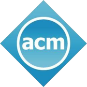

<p align="center">
  
</p>

<h1 align="center">ACM IIT Mandi</h1>

<p align="center">
  The website of the <strong>ACM Student Chapter</strong> and <strong>ACM-W Student Chapter</strong> at IIT Mandi:
  workshops, coding contests, open-source projects and placement preparation for students on the Kamand campus.
</p>

<p align="center">
  
  
  
  
</p>

---

## Pages

| Route | What's there |
| --- | --- |
| `/` | Home: chapter intro and annual events |
| `/about` | About the ACM chapter |
| `/acm-w` | The ACM-W chapter and its programmes |
| `/team` | Executive committee, mentors, core team and ACM-W committee |
| `/events` | Upcoming and past events, plus the chapter's annual events |
| `/projects` | Public repositories, pulled live from the [ACM-IIT-Mandi](https://github.com/ACM-IIT-Mandi) GitHub org |
| `/resources` | Curated ACM and computing resources |
| `/contact` | Email, socials and campus location |
| `/join`, `/code-of-conduct` | Text pages |

## Getting started

You need [Node.js](https://nodejs.org/) 20.19+ or 22.12+ (required by Vite 7).

```bash
git clone https://github.com/ABHISHEKSHAHI597/ACM-Website.git
cd ACM-Website
npm install
npm run dev
```

The dev server runs at <http://localhost:5173>.

| Script | Does |
| --- | --- |
| `npm run dev` | Start the dev server with hot reload |
| `npm run build` | Build for production into `dist/` |
| `npm run preview` | Serve the production build locally |
| `npm run lint` | Run ESLint |

## Updating content

Most of the site's content lives in plain data files, so changing it doesn't mean touching any components.

| To change… | Edit |
| --- | --- |
| Chapter name, email, social links, institute details | [`src/data/chapter.js`](src/data/chapter.js) |
| Team members and roles | [`src/data/team.js`](src/data/team.js) |
| Team photos | [`public/images/team/`](public/images/team/) |
| Upcoming events and annual events | [`src/data/events.js`](src/data/events.js) |
| Resources list | [`public/resources.json`](public/resources.json) |
| Join and Code of Conduct text | [`src/pages/InfoPage.jsx`](src/pages/InfoPage.jsx) |

Any field set to `null` in these files is hidden on the site, so you can leave out details you don't have yet.

### Adding a team member

1. Put a square photo in `public/images/team/` named after the person, e.g. `jane-doe.jpg`.
2. Add an entry to the right group in `src/data/team.js`:

   ```js
   { name: "Jane Doe", role: "Core Member", github: "janedoe", image: "/images/team/jane-doe.jpg" },
   ```

   `github` is a GitHub username. Set it to `null` if you don't want a link.

### Adding an event

Add an object to the `events` array in `src/data/events.js`:

```js
{
  title: "Intro to competitive programming",
  date: "2026-11-20",          // ISO date; decides whether it shows as upcoming or past
  time: "6:00 pm",
  venue: "A10, North Campus",
  chapter: "ACM",              // "ACM" or "ACM-W"
  description: "One or two sentences about the session.",
  imageUrl: "https://...",     // optional
  registerUrl: "https://...",  // optional
}
```

Events are sorted into upcoming and past automatically by date.

### Adding a resource

Add an entry to `public/resources.json`:

```json
{
  "id": "unique-slug",
  "title": "Resource name",
  "description": "One line on what it's for.",
  "category": "Learning",
  "url": "https://..."
}
```

## Project structure

```
├── index.html            # HTML shell, meta tags and favicon
├── public/               # Static files served as-is (logo, photos, resources.json)
└── src/
    ├── main.jsx          # Entry point
    ├── App.jsx           # Routes and layout
    ├── index.css         # Tailwind setup and design tokens
    ├── components/       # Navbar, footer, cards and shared page blocks
    ├── pages/            # One component per route
    ├── data/             # Chapter, team and event content
    └── hooks/            # Data fetching (GitHub repos, resources)
```

## Contributing

1. Fork the repo and create a branch: `git checkout -b my-change`
2. Make your change and run `npm run lint` and `npm run build` to check it.
3. Open a pull request describing what you changed.

For content fixes like a wrong name or a missing event, a pull request that edits the data file is enough. You can also email us.

## Contact

- Email: [acmchapter@students.iitmandi.ac.in](mailto:acmchapter@students.iitmandi.ac.in)
- Instagram: [@acm_iitmandi](https://www.instagram.com/acm_iitmandi/)
- LinkedIn: [ACM IIT Mandi](https://www.linkedin.com/company/acm-iit-mandi/) · [ACM-W IIT Mandi](https://www.linkedin.com/company/iit-mandi-acm-w-chapter/)
- GitHub: [ACM-IIT-Mandi](https://github.com/ACM-IIT-Mandi)

<p align="center"><sub>Made by the ACM IIT Mandi web team, Kamand, Himachal Pradesh.</sub></p>
