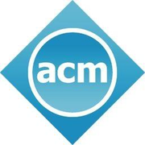

<p align="center">
  <a href="https://acm.iitmandi.co.in">
    
  </a>
</p>

<h1 align="center">ACM IIT Mandi</h1>

<p align="center">
  Official website of the <strong>ACM Student Chapter</strong> and the <strong>ACM-W Student Chapter</strong>,<br />
  Indian Institute of Technology Mandi
</p>

<p align="center">
  <a href="https://acm.iitmandi.co.in"><strong>acm.iitmandi.co.in</strong></a>
</p>

<p align="center">
  <a href="https://acm.iitmandi.co.in"></a>
  <a href="LICENSE"></a>
  <a href="https://github.com/ACM-IIT-Mandi/ACM-Website/pulls"></a>
</p>

<p align="center">
  <a href="https://acm.iitmandi.co.in/events">Events</a> ·
  <a href="https://acm.iitmandi.co.in/team">Team</a> ·
  <a href="https://acm.iitmandi.co.in/projects">Projects</a> ·
  <a href="https://acm.iitmandi.co.in/resources">Resources</a> ·
  <a href="https://acm.iitmandi.co.in/contact">Contact</a>
</p>

---

## About the chapter

The **ACM Student Chapter at IIT Mandi** is the campus chapter of the [Association for Computing Machinery](https://www.acm.org/), the world's largest educational and scientific computing society. We bring together students at the Kamand campus who are interested in computing through workshops, coding contests, talks, open-source projects and placement preparation.

The **ACM-W Student Chapter**, founded in 2019, works to support, celebrate and advocate for women in computing, through mentorship, outreach and its own programme of events.

## About this repository

This repository contains the source code of the chapters' official website, [acm.iitmandi.co.in](https://acm.iitmandi.co.in). It is maintained by the ACM IIT Mandi Web Team.

**Built with:** [React 19](https://react.dev/) · [Vite 7](https://vite.dev/) · [Tailwind CSS 4](https://tailwindcss.com/) · [React Router 7](https://reactrouter.com/) · [Three.js](https://threejs.org/)

### Site map

| Route | Contents |
| --- | --- |
| `/` | Chapter introduction and annual events |
| `/about` | About the ACM chapter |
| `/acm-w` | The ACM-W chapter and its programmes |
| `/team` | Executive committee, mentors, core team and ACM-W committee |
| `/events` | Upcoming and past events |
| `/projects` | Public repositories, fetched live from the [ACM-IIT-Mandi](https://github.com/ACM-IIT-Mandi) GitHub organisation |
| `/resources` | Curated ACM and computing resources |
| `/contact` | Email, social links and campus location |
| `/join`, `/code-of-conduct` | Membership information and Code of Conduct |

## Getting started

**Prerequisites:** [Node.js](https://nodejs.org/) 20.19+ or 22.12+ (required by Vite 7).

```bash
git clone https://github.com/ACM-IIT-Mandi/ACM-Website.git
cd ACM-Website
npm install
npm run dev
```

The development server runs at <http://localhost:5173>.

| Command | Description |
| --- | --- |
| `npm run dev` | Start the development server with hot reload |
| `npm run build` | Create a production build in `dist/` |
| `npm run preview` | Serve the production build locally |
| `npm run lint` | Run ESLint |

## Updating content

Most of the site's content lives in plain data files, so routine updates do not require changes to any components.

| To change… | Edit |
| --- | --- |
| Chapter name, email, social links, institute details | [`src/data/chapter.js`](src/data/chapter.js) |
| Team members and roles | [`src/data/team.js`](src/data/team.js) |
| Team photos | [`public/images/team/`](public/images/team/) |
| Upcoming and annual events | [`src/data/events.js`](src/data/events.js) |
| Resources list | [`public/resources.json`](public/resources.json) |
| Join and Code of Conduct text | [`src/pages/InfoPage.jsx`](src/pages/InfoPage.jsx) |

Any field set to `null` in these files is hidden on the site.

<details>
<summary><strong>Adding a team member</strong></summary>

1. Add a square photo to `public/images/team/`, named after the person, e.g. `jane-doe.jpg`.
2. Add an entry to the appropriate group in `src/data/team.js`:

   ```js
   { name: "Jane Doe", role: "Core Member", github: "janedoe", image: "/images/team/jane-doe.jpg" },
   ```

   `github` is a GitHub username; set it to `null` to omit the link.

</details>

<details>
<summary><strong>Adding an event</strong></summary>

Add an object to the `events` array in `src/data/events.js`:

```js
{
  title: "Intro to competitive programming",
  date: "2026-11-20",          // ISO date; determines whether it is listed as upcoming or past
  time: "6:00 pm",
  venue: "A10, North Campus",
  chapter: "ACM",              // "ACM" or "ACM-W"
  description: "One or two sentences about the session.",
  imageUrl: "https://...",     // optional
  registerUrl: "https://...",  // optional
}
```

Events are sorted into upcoming and past automatically by date.

</details>

<details>
<summary><strong>Adding a resource</strong></summary>

Add an entry to `public/resources.json`:

```json
{
  "id": "unique-slug",
  "title": "Resource name",
  "description": "One line on what it's for.",
  "category": "Learning",
  "url": "https://..."
}
```

</details>

## Project structure

```
├── index.html            # HTML shell, meta tags and favicon
├── public/               # Static assets served as-is (logo, photos, resources.json)
└── src/
    ├── main.jsx          # Entry point
    ├── App.jsx           # Routes and layout
    ├── index.css         # Tailwind setup and design tokens
    ├── components/       # Navbar, footer, cards and shared page blocks
    ├── pages/            # One component per route
    ├── data/             # Chapter, team and event content
    └── hooks/            # Data fetching (GitHub repositories, resources)
```

## Contributing

Contributions from IIT Mandi students are welcome, whether it's fixing a typo, updating event details or improving the site itself.

1. Fork the repository and create a branch: `git checkout -b fix/event-date`
2. Make your changes, then run `npm run lint` and `npm run build` to check them.
3. Open a pull request against `main` describing what you changed and why.

Pull requests are reviewed by the Web Team before being merged and deployed. For content corrections such as a wrong name or a missing event, a pull request that edits the relevant data file is enough. You can also [open an issue](https://github.com/ACM-IIT-Mandi/ACM-Website/issues) or email us.

All contributors are expected to follow the chapter's [Code of Conduct](https://acm.iitmandi.co.in/code-of-conduct).

## Contact

| | |
| --- | --- |
| Email | [acmchapter@students.iitmandi.ac.in](mailto:acmchapter@students.iitmandi.ac.in) |
| Website | [acm.iitmandi.co.in](https://acm.iitmandi.co.in) |
| Instagram | [@acm_iitmandi](https://www.instagram.com/acm_iitmandi/) |
| LinkedIn | [ACM IIT Mandi](https://www.linkedin.com/company/acm-iit-mandi/) · [ACM-W IIT Mandi](https://www.linkedin.com/company/iit-mandi-acm-w-chapter/) |
| GitHub | [ACM-IIT-Mandi](https://github.com/ACM-IIT-Mandi) |

## License

This project is licensed under the [MIT License](LICENSE).

---

<p align="center">
  <sub>© 2026 ACM Student Chapter, IIT Mandi · Kamand, Himachal Pradesh, India</sub>
</p>
